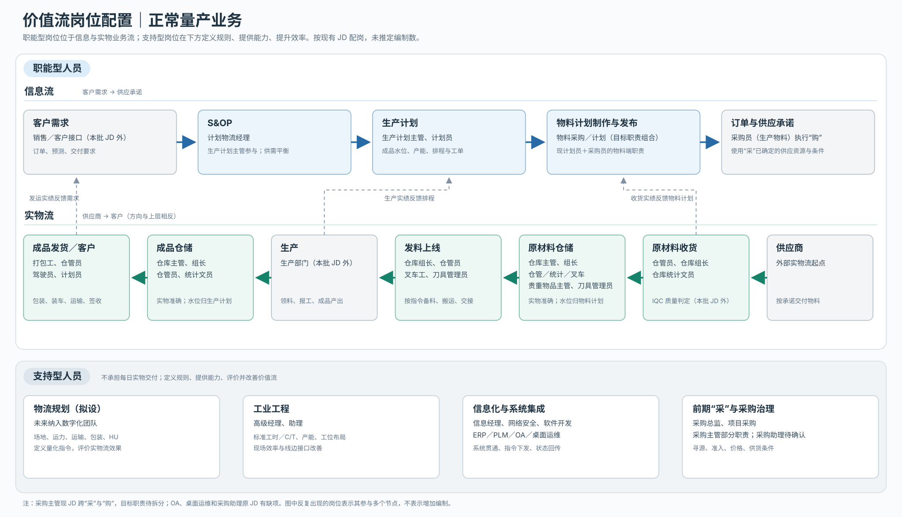

# 价值流岗位配置｜讨论稿

按《价值流_A4_横向.pdf》的线路配置**岗位**，不推定具体人员姓名、编制数或汇报关系。上层信息流从客户需求走向供应商；下层实物流从供应商走向客户。岗位分为直接承担正常业务流结果的“职能型”，以及定义规则、提供技术与改善能力的“支持型”。目标分工依据本轮讨论；现有 JD 与目标分工不同的地方在末尾列出。

## 一、职能型岗位：直接处于价值流

| 价值流节点 | 目标主责 | 现有 JD 可承接的岗位 | 主要交付与边界 |
|---|---|---|---|
| 客户需求输入 | 销售/客户接口，属本批 JD 外 | 本批 JD 无 | 提供订单与预测；计划团队接收并确认有效需求。 |
| S&OP | 计划物流经理 | 计划物流经理；生产计划主管参与 | 平衡需求、产能、库存和供应约束，确认滚动计划与决策。 |
| 生产计划 | 生产计划主管主责；计划员执行 | 生产计划主管、计划员 | 使用 IE 已批准的工时/产能数据，确定成品库存目标、排程、工单及交付节奏。 |
| 物料计划制作与发布 | **物料采购／计划**主责，拟由现有计划员与生产物料采购员职责重组 | 计划员的物料需求职责；采购员的日常下单/跟催职责 | 使用已发布 BOM，计算净需求，控制物料库存水位；按 HU 整数倍和供应商 MOQ 制定补货量，发布采购/到货计划。 |
| 供应商订单与承诺 | 物料采购／计划执行生产物料的“购”；已批准供应商与商业条件来自“采” | 采购员的生产物料采购职责 | 下单、确认供应商交期、跟踪到货；对生产稳定供料及物料库存共同负责。非生产采购另行划定。 |
| 原材料收货 | 仓库收货；IQC 判定质量 | 仓管员、仓库组长、仓库统计文员；IQC 不在本批 JD | 核对数量、标识、单据，完成验收、质量状态和系统入库交接。仓库不代替 IQC 作质量判定。 |
| 原材料仓储 | 仓库主管对运营结果负责，班组执行 | 仓库主管、仓库组长、仓管员、仓库统计文员、叉车工；贵重物品主管和刀具管理员负责专库 | 保管、批次/库位、盘点、账实准确；库存**水位决策**仍归物料采购／计划。 |
| 发料上线 | 仓库按生产指令执行 | 仓库组长、仓管员、叉车工、刀具管理员 | 按工单/BOM/批次备料、搬运、线边交接并回传数量和时间。 |
| 生产 | 生产部门，属本批 JD 外 | 本批 JD 无生产操作岗位 | 消耗物料、完成报工与成品产出；生产计划跟踪计划达成。 |
| 成品仓储 | 仓库负责实物；生产计划负责成品库存水位 | 仓库主管、仓库组长、仓管员、仓库统计文员 | 成品接收、保管、盘点、可发货数量与状态回传。 |
| 成品发货与运输 | 仓库备货交接；计划物流安排交付；驾驶员执行 | 打包工、仓管员、仓库组长、计划员、驾驶员 | 包装、复核、装车、运输、签收和回单；生产计划负责成品交付节奏。 |

**职能型岗位清单（按现有岗位名称）：**计划物流经理、生产计划主管、计划员、采购员（生产物料职责）、仓库主管、贵重物品主管、仓库组长、仓库统计文员、仓管员、叉车工、刀具管理员、打包工、驾驶员。目标组织中的“物料采购／计划”是职责组合，**不是在现有 13 个岗位之外直接增加一个编制**；采购员的非生产采购职责尚待划分。

## 二、支持型岗位：设计规则、技术实现、提升效率

| 支持能力 | 岗位配置 | 对价值流的具体支持 |
|---|---|---|
| 实物流系统规划 | **物流规划（拟设，未来纳入数字化团队）** | 定义场地、库位、内外运力、运输方案、包装、HU、搬运路径；把数量、位置、时间窗、优先级等转为动态作业指令，并评价执行效果。该岗不负责每日收发或驾驶。 |
| 工业工程 | 工业工程部高级经理、工业工程部助理 | 测定并批准工时/C/T与标准产能；优化工位、产线布局、线边补料与搬运效率。Capa & planning 程序使用其已批准的数据。 |
| 信息架构与集成 | 信息经理、软件工程师、ERP 运维工程师、PLM 运维工程师 | 建立跨系统流程和接口，使计划、采购、仓储、生产数据与作业指令贯通；确保状态、版本、回执一致。业务规则由相应职能定义，信息团队实现与维护。 |
| 基础设施与安全 | 网络及信息安全工程师 | 保障工厂网络、终端连接、安全策略、系统可用性和数据安全。 |
| OA 与桌面支持 | OA 运维工程师、桌面运维工程师（JD 待补齐） | 岗位属于支持型，但原工作表缺少可核验的工作动作，暂不细分其职责。 |
| 供应商开发与采购治理（“采”） | 采购总监、项目采购；采购主管的供应商/价格/合同治理部分 | 寻源、准入、价格/商业条款、供应商能力与风险、项目阶段导入；为量产“购”提供已批准供应资源与条件。 |
| 采购辅助 | 采购助理（岗位定义待确认） | 原 JD 标题与岗位字段冲突，暂不确定具体支持动作与归属。 |

## 三、需要在目标组织中拆分或确认的岗位

1. **计划员／采购员：**两份 JD 当前分别包含物料需求与日常采购动作。目标“物料采购／计划”把两类动作接成一个结果责任，但仍需明确工单排程由生产计划岗位负责、供应商商业条件由“采”负责。
2. **采购主管：**现 JD 同时写子公司日常采购监督与供应商/成本管理。目标组织需拆成量产“购”的运营监督和“采”的供应资源治理；不能仅按现岗位名称整体归入一个团队。
3. **仓库主管：**负责实物、账实、安全与作业达成；物料及成品库存目标分别由物料采购／计划、生产计划决定。现 JD 的库存管控措辞需要按“实物准确”和“库存水位”拆开。
4. **物流规划与 IE：**物流规划对厂内外实物流整体方案负责；IE 对产线工位、标准工时和效率负责。线边库位、补料频次、搬运设备等交界处共同评审。
5. **项目采购交接：**项目阶段由项目管理组织交接；项目采购提供供应商、价格、样件与量产准备材料，量产物料采购／计划接收并负责后续供料。

## 四、目前不展开的内容

- 技术更改的多功能表决、BOM 定义与生效由既有流程和相应技术职能负责。本图中的团队使用已发布 BOM，并执行旧料收尾与新料爬坡。
- 缺料发生后进入公司的缺料管理程序。本轮只画正常业务流；该程序尚未取得，不在本图推定触发细则。
- 本批文件不含销售、项目管理、IQC、生产操作岗位 JD；它们在价值流中是必要节点，但不据此推定其具体编制。

## 五、资料依据

- `/Users/lijiajun/Documents/GitHub/Li-Jiajun/浙江海威/价值流_A4_横向.pdf`
- `/Users/lijiajun/Documents/IT、工业工程部、采购、计划物流/9、计划物流部-部门职责及岗位说明书模版(合并)260408.xlsx`
- `/Users/lijiajun/Documents/IT、工业工程部、采购、计划物流/采购部-JD更新20260430.xlsx`
- `/Users/lijiajun/Documents/IT、工业工程部、采购、计划物流/工业工程部-部门职责及岗位说明书260320.xlsx`
- `/Users/lijiajun/Documents/IT、工业工程部、采购、计划物流/信息部-部门职责及岗位说明书260318.xlsx`
