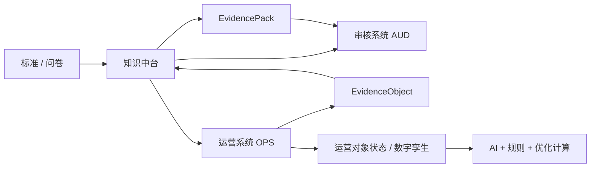
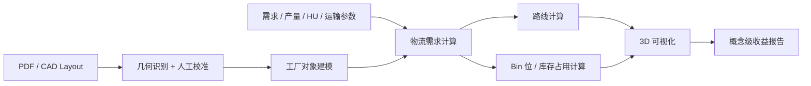
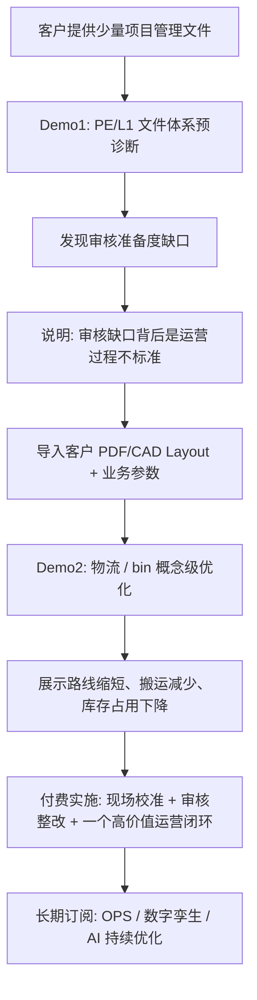

# Demo1 / Demo2 产品定义与开发指导

> 版本：`demo-definition-v0.1-2026-08-17`  
> 状态：讨论稿 / 开发输入  
> 适用范围：售前 Demo、第一期开发范围澄清、后续 OPS / 数字孪生演进对齐  
> 上游依据：`功能架构总览-整合版.md`、VDA6.8 L1 项目管理执行卡、PE-L1 标准过程流、EvidenceObject 跨系统契约、制造运营对象模型相关历史材料

---

## 1. 文档目的

本文档用于把当前系统既有材料与新的售前 Demo 方向合并，形成后续开发可执行的产品定义。

本阶段只定义两个 Demo：

| Demo | 对外定位 | 内部定位 | 主要目的 |
|---|---|---|---|
| Demo1 | VDA6.8 项目管理文件体系预诊断 | 客户文档 → 标准过程模型 → PE/L1 从严评价 | 建立审核专业信任 |
| Demo2 | 工厂物流与仓储概念级优化数字孪生 | PDF/CAD Layout + 业务参数 → route / bin rough 方案 | 让老板看到运营收益空间 |

两个 Demo 的共同叙事：

> 先用审核项目获得客户、流程权限与现场数据，再识别该客户最昂贵的一种运营偏差，交付一个可以量化收益的闭环；后续通过 OPS / AI / 数字孪生持续优化，形成长期软件服务收入。

---

## 2. 与既有总体架构的关系

既有总体架构中的主链保持不变：

本 Demo 阶段的落点：

| 架构层 | Demo1 使用方式 | Demo2 使用方式 |
|---|---|---|
| Layer 1-4 知识中台 | 使用 VDA6.8 PE/L1 条款、REQ、ACT、证据类型、过程流 | 使用对象建模原则，不做完整知识中台下发 |
| Layer 5 过程蓝图 | 读取 PE-L1 标准过程模型，与客户文档还原出的过程做对比 | 建立工厂 layout / 物流 / 仓储概念过程模型 |
| Layer 6 控制计划 | 不做执行控制，只给缺口与建议 | 不做生产控制，只给 route / bin 粗方案 |
| Layer 7 执行与证据 | 售前不接客户 OPS，不生成正式 EvidenceObject | 售前不接 ERP/MES/WMS，只使用客户提供参数 |
| Layer 8 符合性证明 | 输出“文件定义层面的审核准备度” | 不输出审核结论 |
| Layer 9 持续改进 | 给出付费后整改路径 | 给出付费后现场校准与持续优化路径 |

关键原则：

> Demo 不是另起一套演示逻辑，而是用最小可展示范围提前露出终态系统的骨架。

---

## 3. Demo1：VDA6.8 PE/L1 项目管理文件体系预诊断

### 3.1 对外名称

建议对客户使用以下名称之一：

- VDA6.8 项目管理文件体系预诊断
- VDA6.8 PE 项目管理桌面预评审
- VDA6.8 项目管理审核准备度扫描

避免使用：

- 自动审核
- 审核通过率预测
- 文档扫描即可判断现场符合性

### 3.2 核心边界

Demo1 只评价“非物理现场运作也可以合理展开判断”的内容。

当前第一期选择：

| 项目 | 定义 |
|---|---|
| 标准范围 | VDA6.8 |
| 过程范围 | PE / L1 项目管理 / 战略 |
| 评价对象 | 客户提供的项目管理相关制度、流程、模板、记录、矩阵、会议纪要等 |
| 评价性质 | 文件定义层面的审核准备度 |
| 评价口径 | 从严评价 |

不评价：

- 现场真实执行是否发生
- 设备、仓储、物流路线、人员行为等物理环境符合性
- 企业是否能正式通过 VDA6.8 审核

### 3.3 既有材料复用

| 既有材料 | 用途 |
|---|---|
| `VDA6.8-知识中台与ABC三层-唯一说明.md` | 使用 A/B/C 三层逻辑：评分锚点、必要动作、取证向导 |
| `L1-项目管理-一线执行卡.md` | 作为 L1 项目管理标准动作库，含 ACT、REQ、谁做、何时、交什么证、易漏点 |
| `PE-L1-v0.md/json` | 作为 L1 标准过程脊柱流，支持客户文档还原过程的差异对比 |
| `EvidenceObject 跨系统契约` | 作为未来付费后文档 / 记录入库与 EvidencePack 的方向约束 |
| `vda68-web` 现有评分逻辑 | 后续可复用 VDA6.8 条款展示、评分、报告、LOP 生成能力 |

### 3.4 输入

售前 Demo 可接受的客户文件类型：

| 文件类型 | 示例 |
|---|---|
| 程序文件 | 项目管理程序、变更管理程序、可行性分析程序、信息管理程序 |
| 矩阵类文件 | 项目需求矩阵、合规矩阵、WBS 映射表、责任矩阵 |
| 记录类文件 | 里程碑评审纪要、项目启动会记录、变更记录、培训记录、开口项台账 |
| 模板类文件 | 项目数据包模板、可行性分析报告模板、项目风险清单模板 |

输入要求：

- 支持 PDF、Word、Excel。
- 文件必须由客户明确授权用于预诊断。
- 售前阶段建议只要求 5-15 份代表性文件，避免免费交付过深服务。

### 3.5 处理逻辑

核心步骤：

| 步骤 | 说明 |
|---|---|
| 文档解析 | 抽取标题、章节、职责、触发条件、记录名称、表格字段、审批信息 |
| 过程还原 | 从客户文件中生成“客户项目管理过程图” |
| 标准映射 | 将客户过程节点映射到 PE-L1 标准过程脊柱流与 L1 执行卡 |
| 缺口识别 | 对比缺失动作、缺失角色、缺失证据、缺失门禁、缺失版本控制 |
| 从严评价 | 对证据不足、文件未定义、职责模糊、闭环缺失按不利方向判断 |
| 结果输出 | 输出通用评分 + VDA6.8 PE/L1 问题项评价 + 证据定位 |

### 3.6 评分口径

Demo1 输出两层评分。

第一层：通用过程评分。

| 维度 | 评价重点 |
|---|---|
| 文件定义完整性 | 是否定义流程、模板、记录、适用范围、版本、生效规则 |
| 过程接口清晰度 | 输入、输出、前后过程、里程碑、触发条件是否清楚 |
| 职责权限清晰度 | 谁做、谁复核、谁批准、谁被通知是否清楚 |
| 记录证据充分性 | 是否有可复现的记录、矩阵、会议纪要、变更记录、培训记录 |
| 风险控制闭环性 | 是否有开口项、变更、升级、关闭、有效性验证机制 |

第二层：VDA6.8 PE/L1 问题项评价。

| 评价状态 | 含义 |
|---|---|
| 满足 | 文件中存在明确、可追溯、可执行、可取证的定义 |
| 部分满足 | 有相关内容，但职责、触发、证据或闭环不完整 |
| 不满足 | 未找到对应定义，或定义无法支持审核判断 |
| 证据不足 | 文档片段不足以形成正向结论，按从严原则提示风险 |
| 不适用待确认 | 可能不适用，但需要客户现场或业务边界确认 |

评分展示必须包含：

- 命中的客户文件名。
- 命中文档位置或段落摘要。
- 对应 VDA6.8 PE/L1 问题项。
- 对应 REQ / ACT。
- 判断理由。
- 需要客户付费后进一步补证或现场确认的内容。

### 3.7 Demo1 输出

Demo1 应至少输出：

| 输出 | 内容 |
|---|---|
| 审核准备度总览 | 雷达图 / 总分 / 风险等级 |
| PE/L1 问题项评价表 | 逐项显示满足、部分满足、不满足、证据不足 |
| 客户过程图 | 从客户文件还原出的项目管理过程 |
| 标准差异图 | 客户过程 vs PE-L1 标准过程模型 |
| 缺口清单 | 缺失动作、缺失证据、缺失角色、缺失闭环 |
| 付费整改建议 | 只给方向，不给完整可执行整改包 |

### 3.8 不可承诺内容

Demo1 不承诺：

- 给出正式审核结论。
- 证明企业能通过 VDA6.8。
- 基于文档评价物理现场运作。
- 免费输出完整整改方案、完整模板包、完整 SOP。
- 替代审核员现场判断。

### 3.9 售前话术

建议表达：

> 这个预诊断只针对 VDA6.8 PE 项目管理中可以通过文件体系展开判断的部分。系统会把客户文件还原为业务过程，并与标准过程模型做差异对比，输出文件定义层面的审核准备度。真正的现场符合性、证据闭环和整改落地，需要进入付费实施后完成。

---

## 4. Demo2：物流路线与仓储 Bin 位概念级优化数字孪生

### 4.1 对外名称

建议使用：

- 工厂物流与仓储概念级优化数字孪生
- Layout 驱动的厂内物流 / Bin 位优化推演
- 厂内物流路线与库存占用快速诊断

避免使用：

- 自动生成工程级物流规划
- 扫描 Layout 即可完成全厂优化
- 实时数字孪生完整系统

### 4.2 核心边界

Demo2 是售前概念级推演，不是工程级实施方案。

| 项目 | 定义 |
|---|---|
| 输入图纸 | PDF / CAD Layout |
| 业务输入 | 客户需求、产量、班次、包装 HU 标准、运输方式参数、仓储约束 |
| 人工补充 | 关键点位、区域、通道、门、线边库、仓储区、上下料点 |
| 输出范围 | 物流路线缩短、搬运效率提升、仓储 / bin 位数量优化、库存占用下降 |
| 精度等级 | Level 1 概念推演 |

不包含：

- 人员效率、人机组合、排班优化。
- 现场实时定位。
- 工程级货架 / 消防 / 安全 / 土建 / 设备安装规划。
- ERP/MES/WMS/AGV 真实接口。

### 4.3 输入

#### 4.3.1 Layout 输入

第一版只支持：

- PDF 平面图。
- CAD 图纸导出文件。

暂不支持：

- 手绘图。
- 模糊照片。
- 低精度扫描图。

原因：

> Demo2 本身已经是 rough 输出，如果输入图纸不专业，偏差会被放大，反而损害售前可信度。

#### 4.3.2 人工标注输入

售前阶段允许人工标注，且应主动说明。

必须标注：

| 标注对象 | 示例 |
|---|---|
| 固定区域 | 原材料仓、成品仓、线边库、超市区、收货区、发货区 |
| 产线 / 工站 | 产线位置、关键上下料点、瓶颈工站 |
| 通道约束 | 可通行通道、禁行区、单向通道、交叉口 |
| 物流节点 | 取货点、投料点、暂存点、空箱回收点 |
| 垂直约束 | 层高、货架高度、可堆叠限制 |

#### 4.3.3 业务参数输入

| 参数 | 用途 |
|---|---|
| 客户需求 | 推算日需求、班需求、小时需求 |
| 产品 / 物料清单 | 定义需要进入物流和仓储计算的对象 |
| 产量 / 班次 | 计算补料节奏和搬运频次 |
| 包装 HU 标准 | 换算托盘、料箱、周转器具数量和面积 |
| 运输方式 | 区分叉车、AGV、人工搬运、牵引车等 |
| 速度 / 载重 / 装卸时间 | 估算单次搬运时间与设备需求 |
| 安全库存 / 线边库存策略 | 估算 bin 位数量和库存占用 |
| 仓储面积 / 层高 / 货架形式 | 估算库位容量和空间利用率 |

### 4.4 处理逻辑

### 4.5 工厂对象模型

Demo2 不需要一次性实现完整数字孪生，但对象设计必须朝终态兼容。

第一版最小对象：

| 对象 | 说明 | 关键字段 |
|---|---|---|
| `FactorySite` | 工厂 / 厂区 | site_id, name, coordinate_system |
| `Area` | 区域 | area_type, boundary, height, enabled |
| `ProductionLine` | 产线 | line_id, location, takt, capacity |
| `Station` | 工站 / 上下料点 | station_type, line_id, location |
| `WarehouseZone` | 仓储区 | zone_type, area, height, rack_type |
| `BinLocation` | bin 位 / 库位 | location_code, capacity, material_group |
| `Material` | 物料 | material_code, demand_rate, hu_type |
| `HandlingUnit` | 包装 HU | hu_type, qty_per_hu, footprint, stack_limit |
| `TransportMode` | 运输方式 | mode, speed, capacity, load_unload_time |
| `RouteSegment` | 路径段 | from_node, to_node, distance, restriction |
| `MaterialFlow` | 物料流 | material, from, to, frequency, qty |
| `Scenario` | 方案 | baseline / proposed, assumptions, kpi |

付费后再扩展：

| 对象 | 用途 |
|---|---|
| `Worker` / `Skill` / `Shift` / `LocationState` | 人员资格、班次、位置、人机效率 |
| `Machine` / `MachineStatus` | 设备状态、瓶颈、异常影响 |
| `AGVState` / `ForkliftState` | 运输设备实时状态 |
| `InventorySnapshot` | ERP/WMS 库存快照 |
| `ObjectSnapshot` | AI 判断和优化计算的可追溯快照 |
| `AIDecisionLog` | AI 判断审计 |

### 4.6 Route Rough 计算

目标：展示物流路线缩短和搬运效率提升。

最小计算项：

| 指标 | 计算方向 |
|---|---|
| 单次路径距离 | 从仓储 / 超市区到线边上下料点的路径距离 |
| 单次搬运时间 | 距离 / 标准速度 + 装卸时间 + 等待假设 |
| 每班搬运次数 | 班需求量 / 单次装载量 |
| 每班总搬运距离 | 单次距离 × 搬运次数 |
| 每班总搬运时间 | 单次时间 × 搬运次数 |
| 运输设备需求 | 总搬运时间 / 可用工作时间，作为 rough 估算 |
| 拥堵 / 交叉风险 | 路径交叉点、共用通道、反复折返提示 |

输出必须同时显示：

- Baseline 当前方案。
- Proposed 推荐方案。
- 差异百分比。
- 关键假设。

### 4.7 Bin / 库存 Rough 计算

目标：展示仓储 / bin 位数量优化和库存占用下降。

最小计算项：

| 指标 | 计算方向 |
|---|---|
| 物料班需求 | 客户需求 / 班次 / BOM 或物料需求系数 |
| HU 数量 | 需求量 / 每 HU 容量 |
| 线边库存 | 补料周期 × 消耗速度 + 安全量 |
| 仓储库存 | 计划库存天数 × 日需求，或客户给定库存策略 |
| bin 位数量 | HU 数量 / 单 bin 容量 / 堆叠层数 |
| 面积占用 | HU footprint × HU 数量 / 堆叠层数 |
| 补料频次 | 线边最大库存 / 消耗速度 |
| 缺料 / 过量风险 | 低于最小库存或高于最大库存时提示 |

输出必须同时显示：

- 当前库存 / bin 估算。
- 推荐库存 / bin 组合。
- 仓库区、线边区、超市区分配。
- 面积占用变化。
- 库存天数变化。
- 计算假设。

### 4.8 3D 展示要求

Demo2 的展示形态应类似室内装修效果图，但核心是运营信息，不是纯视觉。

第一版需要展示：

| 视觉层 | 内容 |
|---|---|
| Layout 3D 底图 | 区域、产线、仓储、通道、门、上下料点 |
| 物流路线 | 当前路线与推荐路线，用不同颜色区分 |
| 物料流动画 | HU / 托盘 / 料箱沿路线移动 |
| bin 位展示 | 仓库与线边区的 bin 数量、占用比例 |
| KPI 面板 | 距离、时间、搬运次数、设备需求、面积占用、库存天数 |
| 假设面板 | 速度、装卸时间、HU、班次、需求、库存策略 |

展示原则：

- 老板第一眼看到路线变短、库位变少、钱在哪里。
- 运营负责人第二眼看到计算假设是否可信。
- 不追求毫米级精度，不承诺工程图纸可直接施工。

### 4.9 精度等级

| 等级 | 名称 | 数据来源 | 可承诺内容 |
|---|---|---|---|
| Level 1 | 概念推演 | PDF/CAD + 手工点位 + 客户业务参数 | 识别收益空间，生成 rough route / bin 方案 |
| Level 2 | 现场校准 | 现场测量 + 真实通道 / 节拍 / 装卸时间 | 输出可落地改善方案 |
| Level 3 | 持续优化 | ERP/MES/WMS/AGV/IoT/定位数据 | 动态重算库存、路线、补料节奏和执行偏差 |

售前 Demo 只承诺 Level 1。

### 4.10 不可承诺内容

Demo2 不承诺：

- 工程级设计精度。
- 自动识别所有 layout 内容。
- 自动完成真实全厂物流规划。
- 替代物流工程师、厂务、安全、消防、设备供应商的确认。
- 免费提供完整可实施改造方案。
- 涉及人员定位、人机效率和排班优化。

### 4.11 售前话术

建议表达：

> 这个 Demo 基于客户 PDF/CAD Layout、产量、班次、HU、运输方式和仓储约束，快速生成一版概念级物流路线与 bin 位优化推演。它的价值不是替代工程实施，而是帮助企业主在购买服务前看到潜在收益空间。进入付费实施后，我们会做现场测量、数据校准和系统接入，把概念方案推进到可落地方案。

---

## 5. Demo1 与 Demo2 的组合演示故事线

推荐售前演示顺序：

一句话版本：

> Demo1 让客户相信你能帮他过审，Demo2 让老板相信系统能持续帮他省钱。

---

## 6. 第一版开发范围建议

### 6.1 Demo1 MVP

| 模块 | 第一版能力 |
|---|---|
| 文件上传 | PDF / Word / Excel 上传与项目归档 |
| 文档解析 | 抽取文本、表格、标题、职责、记录名称 |
| PE-L1 标准模型 | 读取或内置 PE-L1 标准过程节点、REQ、ACT、证据类型 |
| 映射引擎 | 客户文档片段 → 标准过程节点 / ACT / 问题项 |
| 评分引擎 | 5 个通用维度 + PE/L1 从严评价 |
| 结果页 | 总览、问题项表、证据定位、缺口清单 |
| 报告导出 | PDF / Markdown / Word 均可，第一版建议 Markdown + PDF |

### 6.2 Demo2 MVP

| 模块 | 第一版能力 |
|---|---|
| Layout 导入 | PDF/CAD 读取；第一版可接受人工转底图 |
| 手工标注 | 区域、产线、通道、上下料点、仓储区、线边区 |
| 参数录入 | 需求、产量、班次、HU、速度、载重、装卸时间、库存策略 |
| Route 计算 | 当前 / 推荐路线距离、时间、搬运次数、设备需求 rough 估算 |
| Bin 计算 | HU、bin 数、面积、库存天数、补料频次 rough 估算 |
| 3D 可视化 | layout 立体化、路线、物料流、bin 占用、KPI 面板 |
| 方案对比 | Baseline vs Proposed |
| 报告导出 | 概念级收益报告，含假设与不可承诺边界 |

---

## 7. 数据对象与接口方向

### 7.1 Demo1 数据对象

| 对象 | 说明 |
|---|---|
| `UploadedDocument` | 客户上传文件 |
| `ExtractedFragment` | 文档片段 / 表格 / 条款 / 记录字段 |
| `CustomerProcessNode` | 从客户文件还原出的过程节点 |
| `StandardProcessNode` | PE-L1 标准过程节点 |
| `RequirementMapping` | 客户片段与 REQ / ACT / Clause 的映射 |
| `AssessmentFinding` | 评价发现 |
| `Demo1Report` | 预诊断报告 |

### 7.2 Demo2 数据对象

参见 4.5 第一版最小对象。

### 7.3 未来接口方向

第一版 Demo 可以单机或离线运行，但对象命名应预留未来接口。

后续付费实施可接入：

| 系统 | 数据 |
|---|---|
| ERP | 客户需求、订单、物料、库存策略 |
| MES | 工单、产量、节拍、设备状态 |
| WMS | 库存、库位、出入库、批次 |
| AGV / 叉车系统 | 任务、速度、路径、状态 |
| IoT / 定位系统 | 设备、运输工具、人员位置与状态 |

原则：

> 核心系统不依赖单一硬件供应商，硬件只提供状态数据；对象模型、判断逻辑和优化收益归系统所有。

---

## 8. 付费后升级路径

| 阶段 | 客户购买内容 | 系统升级 |
|---|---|---|
| 售前 | Demo1 + Demo2 展示 | 文件预诊断 + 概念级 route / bin 推演 |
| 项目实施 1 | 审核整改服务 | PE/L1 扩展到更多 VDA6.8 过程，产出整改计划与证据闭环 |
| 项目实施 2 | 现场校准服务 | Layout 实测、物流时间测量、仓储数据校验、方案工程化 |
| 项目实施 3 | 一个高价值运营闭环 | 例如补料频次优化、线边库存控制、叉车/AGV route 优化 |
| 订阅 1 | OPS 轻量接入 | ERP/MES/WMS 数据快照，周期性重算 |
| 订阅 2 | 数字孪生增强 | 运输设备、库位、物料、设备状态实时化 |
| 订阅 3 | 人员能力层 | 人员资格、班次、工位、状态、位置、人机效率、经验复制 |

人员模块进入付费后，不进入售前 Demo：

> 售前不采集、不展示、不评价人员效率。人员数据只作为付费后高级运营优化能力，用于识别人机组合效率、排班倾斜、培训和 lesson learned，不作为审核评价依据。

---

## 9. 开发验收标准

### 9.1 Demo1 验收

Demo1 可验收条件：

- 能上传至少 5 份 PE/L1 相关客户样例文档。
- 能从文档中抽取职责、流程、记录、矩阵、版本、触发条件。
- 能输出客户项目管理过程图。
- 能与 PE-L1 标准过程模型做差异对比。
- 能按 5 个通用维度评分。
- 能逐条给出 VDA6.8 PE/L1 问题项的从严评价。
- 每条评价能追溯到客户文件片段和标准节点。
- 报告中明确标注“文件定义层面，不代表正式审核结论”。

### 9.2 Demo2 验收

Demo2 可验收条件：

- 能导入或加载一张 PDF/CAD 来源的工厂 layout 底图。
- 能人工标注区域、产线、仓储区、通道、上下料点。
- 能录入需求、产量、班次、HU、运输参数、库存策略。
- 能生成 baseline 与 proposed 两套方案。
- 能计算路线距离、搬运时间、搬运次数、运输设备 rough 需求。
- 能计算 bin 位数量、面积占用、库存天数、补料频次。
- 能以 3D 方式展示 layout、路线、物料流、bin 占用和 KPI。
- 能展示计算假设。
- 报告中明确标注“Level 1 概念推演，不代表工程级规划”。

---

## 10. 关键风险与控制

| 风险 | 控制方式 |
|---|---|
| Demo1 被误解为正式审核 | 所有页面和报告标注“文件定义层面的审核准备度” |
| Demo1 免费交付过多整改价值 | 只输出缺口和方向，不给完整模板和实施包 |
| Demo2 被误解为工程图纸 | 使用 Level 1 / Level 2 / Level 3 精度等级说明 |
| Rough 计算被质疑 | 展示所有关键假设，让客户看到可校准路径 |
| Layout 输入质量差 | 第一版只支持 PDF/CAD，拒绝低质量图像作为正式 demo 输入 |
| 人员数据引发敏感问题 | 售前不采集人员效率；付费后以“能力资源优化”叙事进入 |
| 依赖外协硬件导致系统被绑架 | 定义统一对象 / 状态接口，硬件只提供数据 |
| Fuller 历史材料 IP / 实施依赖 | 只复用已拥有的对象建模思想和文档资产，不依赖 Fuller 团队或实现 |

---

## 11. 下一步建议

建议后续按以下顺序推进：

1. 确认 Demo1 的 PE/L1 样例条款范围，建议先选 5-8 个最能体现“项目管理文件定义”的问题项。
2. 准备一套脱敏客户样例文件，或构造一套高仿真样例文件。
3. 准备一张样板工厂 PDF/CAD layout，用于 Demo2 稳定演示。
4. 定义 Demo2 的参数模板：需求、班次、HU、运输速度、装卸时间、库存策略。
5. 先实现可控样板 demo，再支持客户真实文件 / layout 导入。

开发优先级建议：

> 先做“稳定可演示的样板工厂 + 样板项目文件”，再做“开放输入”。售前 Demo 的第一目标是可信和震撼，不是泛化能力。

