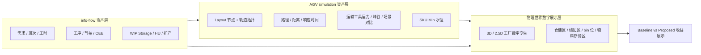
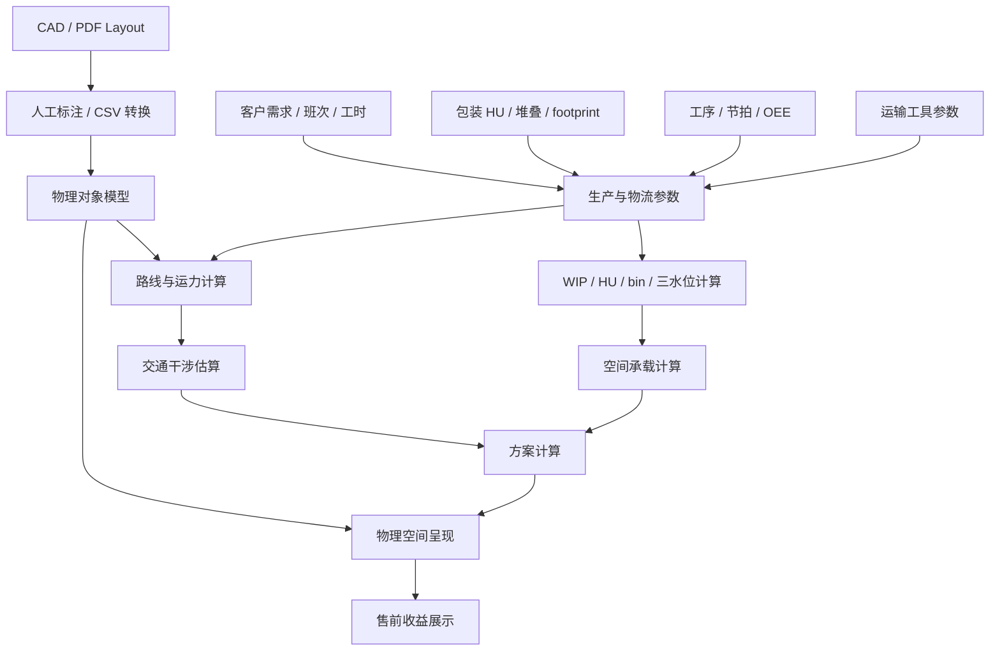

# Demo2 — 物理数字孪生与运营优化独立定义

> 版本：`demo2-twin-ops-v0.2-2026-08-24`  
> 状态：讨论稿 / 开发前产品定义  
> 适用范围：Demo2 独立规划、AGV simulation 与 info-flow 资产融合、后续数字孪生 / OPS 运营系统演进  
> 关联材料：`Demo1-Demo2产品定义与开发指导.md`、`AGV simulation/`、`Archive/info-flow/index.html`

---

## 1. Demo2 的重新定位

Demo2 不应只是“更好看的 3D 工厂效果图”，而应是：

> 将客户工厂的物理世界投影为可计算的运营对象，并允许通过基础参数变化重算物流路线、运输工具运力、线边库存、WIP、仓储 / bin 位和空间占用。

因此，Demo2 的价值不在于“数字化呈现本身”，而在于：

- 物理对象是否被正确建模。
- 物理状态是否能进入计算。
- 参数变化是否能触发重算。
- 计算结果是否能反映到物理场景中。
- 结果是否能解释运营收益。

如果一个数字化呈现无法识别、计算或纠正关键偏差，例如机械臂微小尺寸偏差、线边库存不足、运输响应时间过长、库位面积不足，那么它只是展示，不是数字孪生。

Demo2 的售前核心应表达为：

> 我们不是给客户看一个漂亮工厂模型，而是给客户看“工厂物理世界如何变成可计算、可优化、可持续重算的运营系统”。

---

## 2. 三部分材料的关系

当前与 Demo2 相关的材料可以分为三类。

| 材料 | 当前能力 | 缺口 | 在 Demo2 中的定位 |
|---|---|---|---|
| Demo2 原定义 | 物流路线、仓储 / bin 位、3D 数字孪生售前叙事 | 计算资产尚未展开 | 总体产品壳与售前叙事 |
| `AGV simulation/` | Layout 节点、轨道网络、AGV 运力、响应时间、24h 峰谷、SKU Min 水位 | 缺少仓储物理场景、包装 / bin / 存储区空间展示 | 运输路径与运力计算核心 |
| `Archive/info-flow/` | WIP、产能、班次、需求、HU、设备 / CapEx 计算 | 缺少物理 layout 与空间呈现；缺少极限空间承载上限 | 专业参数录入与 WIP / 库存计算核心 |

三者未来必须协同，但第一版不应把旧 App 直接拼接在一起。

推荐关系：



---

## 3. Demo2 应解决的业务问题

Demo2 第一阶段聚焦两个售前收益：

1. 物流路线缩短、搬运效率提升。
2. 仓储 / bin 位数量优化、库存占用下降。

加入 AGV simulation 与 info-flow 后，Demo2 的表达应升级为：

> 当客户需求、班次、HU、工序节拍、运输工具速度、仓储区面积或线边库存策略变化时，系统可以重新计算路线、运输工具运力、Min / Operating / Max 水位、WIP / bin 需求，并在物理场景中直观呈现变化。

这比单纯的 layout 优化更强，因为它把“现场变化”与“运营重算”连接起来。

同时，Demo2 必须预留两个面向完整系统的能力入口：

1. 扩产或客户需求变化后的物理约束判断。
   - 不是只问“设备产能够不够”。
   - 还要问“仓库面积够不够、线边空间够不够、通道够不够、运输工具运力够不够”。

2. 后续与主程序、ERP / MES / WMS / 运输设备数据源对接。
   - Demo2 第一版可以人工导入和标注。
   - 但对象模型、输入输出接口必须从第一版开始就按完整系统预留。

---

## 4. Demo2 三层功能架构

### 4.1 物理场景层

物理场景层负责表达客户工厂中的实际空间与对象。

第一版应包括：

| 对象 | 说明 | 来源 |
|---|---|---|
| `FactoryLayout` | 厂房边界、通道、生产区、仓储区、收发货区 | Demo2 新增 |
| `ProductionLine` | 产线或生产单元 | AGV simulation + Demo2 新增 |
| `ProductionStation` | 生产工站，即节拍真实发生的物理位置 | AGV simulation + info-flow |
| `DeliveryPoint` | 物料配送目的地，可能在工站旁、线边区或超市边界 | Demo2 新增 |
| `StorageArea` | 原材料仓、成品仓、WIP 区、线边库、超市区 | Demo2 新增 |
| `BinLocation` | 可放置 HU / 托盘 / 料箱的具体物理位置 | Demo2 新增 |
| `PathNetwork` | 通道、路线、交叉口、可通行边 | AGV simulation |
| `RouteNode` | 路径网络中的通行节点，不等同于工站或配送点 | AGV simulation |
| `TransportResource` | AGV、叉车、Dolly 车、地牛、人工拖车等运输工具 | AGV simulation 泛化 |
| `MaterialHU` | 物料编码、HU 类型、HU 容量、占地、堆叠 | AGV simulation + info-flow |

关键补强：

> AGV simulation 已有“节点 + 路线 + 运力”，但缺少“仓储区域 + 存储物理空间 + bin 位占用”的呈现。Demo2 必须补上这一层，否则无法完整表达仓储 / 库存占用下降。

### 4.2 站点与位置对象边界

这一部分必须从第一版就定义清楚，否则后续计算会混乱。

| 对象 | 含义 | 是否产生节拍 | 是否一定是配送目的地 | Demo2 中的用途 |
|---|---|---:|---:|---|
| `ProductionStation` | 工序真实发生的物理工站 | 是 | 不一定 | 绑定工艺步骤、节拍、产能、瓶颈 |
| `DeliveryPoint` | 物料被送达的位置 | 否 | 是 | 计算仓库到线边 / 工站旁的配送距离与补货频率 |
| `StorageArea` | 一片物料存放区域 | 否 | 可能 | 承载 HU / Pallet / Bin / Boxes 的空间需求 |
| `BinLocation` | 一个具体存储位 | 否 | 可能 | 计算库位数量、占地、库存水位 |
| `RouteNode` | 通道网络节点 | 否 | 否 | 用于路径、距离、拥堵和干涉计算 |

关键原则：

1. 生产工站不等于物料配送目的地。
2. 物料配送目的地不等于仓储区。
3. 仓储区不等于具体 Bin 位。
4. 路径节点不等于业务对象。

现实中这些对象可能在同一个物理位置附近，但系统建模时必须分开。比如某个工站旁边有一个线边料架，那么：

- 工站本体是 `ProductionStation`。
- 料架或投料口是 `DeliveryPoint`。
- 料架所在的线边物料区域是 `StorageArea`。
- 料架上的具体格口是 `BinLocation`。

### 4.3 计算引擎层

计算引擎层负责把参数变化转化为可解释结果。

| 计算域 | 能力 | 主要来源 |
|---|---|---|
| 路径距离 | 基于节点 / 轨道网络计算最短路径与距离 | AGV simulation |
| 运输工具运力 | 推荐运输工具数量、峰值需求、单车服务率 | AGV simulation 泛化 |
| 24h 峰谷 | 未来 24h 或滚动窗口的物流需求变化 | AGV simulation |
| SKU Min 水位 | 各物料在线边的最低库存阈值 | AGV simulation |
| WIP Storage | 工序间 WIP / HU 存储需求 | info-flow |
| 产能 / 瓶颈 | 需求、节拍、机器数、利用率、扩产需求 | info-flow |
| bin / 面积 | HU 数量、库位数量、占地面积、堆叠层数 | Demo2 新增 |
| 交通干涉 | 路径重叠、交叉口、运输工具数量、让行损失 | Demo2 新增 |

第一版最重要的新增计算：

```text
HU 数量 × HU footprint × 堆叠限制
→ 所需面积 / 所需 bin 位
→ 映射到仓储区、线边区、WIP 区、配送目的地
→ 显示当前占用、推荐占用与容量风险
```

### 4.4 三水位模型

Demo2 不应只计算一个 WIP 或库存值，而应输出三个具有不同业务含义的水位。

| 水位 | 含义 | 数据来源 / 计算方向 | 业务解释 |
|---|---|---|---|
| `MinPerformanceLevel` | 最优绩效水位 / 精益目标水位 | 由 info-flow 现有逻辑扩展得出 | 在给定预测、节拍、班次和补货假设下，理论上应尽量接近的低库存状态 |
| `OperatingLevel` | 运营水位 / 未来 24H 动态水位 | 由 AGV simulation 的 24H 峰谷与补货节奏扩展得出 | 实际运营过程中，库存与配送需求会如何上下波动 |
| `MaxStressLevel` | 压力上限水位 / 极限承载水位 | Demo2 新增计算 | 在需求上冲、延迟补货、运输响应变差或安全库存抬高时，现场最多需要准备多少物理空间 |

展示原则：

- 每个 `StorageArea`、重要 `DeliveryPoint` 都应能展示三条水位线。
- `OperatingLevel` 原则上应在 `MinPerformanceLevel` 和 `MaxStressLevel` 之间运行。
- 如果 `OperatingLevel` 长期低于 `MinPerformanceLevel`，提示断料或补货不足风险。
- 如果 `OperatingLevel` 超过 `MaxStressLevel`，提示空间承载不足。
- 如果 `OperatingLevel` 接近物理容量上限，提示扩产或需求波动下的现场风险。

特别注意：

- 如果客户预测值本身只是平均值，`MinPerformanceLevel` 并不能天然代表可靠下限。
- `MaxStressLevel` 必须单独定义压力场景，不能简单用平均值放大。
- 三水位最终必须转化为物理占用：HU / Pallet / Boxes 数量 → 占地面积 → 层高 / 堆叠 → Bin 位或区域占用。

### 4.5 扩产与能力约束模型

扩产判断不能只看产线设备是否够用。Demo2 应至少从四类约束判断“哪里先被打满”。

| 约束 | 判断对象 | 典型输入 | 输出 |
|---|---|---|---|
| `ProductionCapacity` | 设备、工站、节拍、OEE | 工序节拍、设备数量、班次、良率 | 产线瓶颈、设备缺口 |
| `StorageCapacity` | 仓库、线边、WIP 区、Bin 位 | HU / Pallet / Boxes、面积、层高、堆叠规则、作业空间 | 空间缺口、库位缺口、线边超载风险 |
| `TransportCapacity` | AGV、叉车、Dolly 车、地牛等运输工具 | 速度、载荷、装卸时间、可用率、CV、数量 | 运力缺口、利用率、响应时间 |
| `TrafficCapacity` | 通道、交叉口、会车点、让行规则 | 路径重叠、通道宽度、运输频次、运输工具数量 | 干涉损失、等待时间、拥堵风险 |

第一版可以用粗粒度参数表达 `TrafficCapacity`：

- `TrafficInterferenceFactor`：交通干涉系数。
- `PathConflictLoss`：路径冲突导致的时间损失。
- `ChannelUtilization`：通道利用率。
- `YieldingLoss`：让行 / 等待损失。

售前 Demo 阶段不需要做高精度多车调度仿真，但必须让客户看到：扩产不是简单增加设备或增加运输工具，运输工具增加后可能进一步抬高通道冲突、响应时间和下工序 WIP 水位。

### 4.6 展示与决策层

展示层面向两类人：

| 受众 | 需要看到什么 |
|---|---|
| 老板 / owner | 路线缩短、运输工具数量减少或利用率提升、库存占用下降、面积释放、收益空间 |
| 专业团队 | 参数、假设、计算公式、工站 / 配送点 / 物料明细、WIP / bin / route 结果 |

因此 Demo2 应提供两个视图：

1. 老板视图：更清晰、更性感的物理世界数字展示，突出变化和收益。
2. 专业视图：类似 info-flow 的参数录入和计算结果表，供专业团队核查假设。

---

## 5. 与 AGV simulation 的关系

AGV simulation 可作为 Demo2 的“运输路径与运力计算核心”，但不应原样成为 Demo2 页面，也不应把 Demo2 锁死为 AGV 系统。

更准确的抽象是：

> AGV 是 `TransportResource` 的一种。叉车、Dolly 车、地牛、人工拖车等，也都应按速度、载荷、装卸时间、可用率、CV、路径约束进行统一评估。

### 5.1 可复用资产

| 资产 | 复用方式 |
|---|---|
| `Depot` | 映射为仓库 / 供料起点 |
| `SubLine` / `FinalLine` | 先映射为物理点，再由人工标注为生产工站或配送目的地 |
| `OperationPoint` | 映射为通道节点 / 路径通过点 |
| `connectedTo` | 映射为可通行路径边 |
| Dijkstra / track distance | 用于路线距离和响应时间计算 |
| `scaleFactor` | 用于坐标到物理距离换算 |
| CSV 双模板 | 作为售前 layout 半结构化导入方式 |
| 场景对比 | 用于 Baseline vs Proposed |
| 24h 滚动窗口 | 用于未来峰谷变化展示 |
| SKU Min 水位 | 用于线边库存和补料策略 |

### 5.2 不直接复用的部分

| 内容 | 原因 |
|---|---|
| 旧 UI 整体 | 偏工程工具，售前不够聚焦 |
| 旧品牌 / Audi 风格 | 与新系统品牌不一致 |
| 复杂 Monte Carlo 操作 | 可作为高级功能，第一版不放主线 |
| 多语言完整体系 | Demo2 第一版不需要三语完整支持 |
| 原始单页大 JS | 需拆为可维护模块，不直接嵌入 |

### 5.3 Demo2 中的映射

| AGV simulation | Demo2 标准对象 |
|---|---|
| `Depot` | `StorageArea` / `SupplyNode` |
| `SubLine` | 物理点，后续标注为 `ProductionStation` 或 `DeliveryPoint` |
| `FinalLine` | `ProductionLine` / `ProductionStation` |
| `OperationPoint` | `RouteNode` |
| `connectedTo` | `RouteSegment` |
| `Material` | `MaterialFlow` |
| `maxHU` | `LineSideMaxInventory` |
| `huFillSize` | `HandlingUnit.qty_per_hu` |
| `trigger` | `ReplenishmentPolicy` |
| `responseTimeMatrix` | `TravelTimeMatrix` |

---

## 6. 与 info-flow 的关系

info-flow 可作为 Demo2 的“专业计算与参数录入资产”，但不应作为老板视图的主界面。

### 6.1 可复用资产

| 资产 | 复用方式 |
|---|---|
| `ProcessStep` | 映射为工序 / 工站生产能力 |
| 月需求 | 映射为 Scenario demand |
| 班次 / 工时 | 映射为生产时间窗口 |
| 标准加工时间 | 映射为节拍 / cycle time |
| 机器数 / 利用率 / OEE | 用于瓶颈和产能判断 |
| HU | 用于 WIP / bin / 面积计算 |
| WIP Storage | 用于工序间存储需求 |
| 扩产需求 | 用于 CapEx / 产能风险提示 |

### 6.2 在 Demo2 中的定位

info-flow 更适合作为：

> 专业团队数据录入与计算核查界面。

它可以放在 Demo2 的“专业参数页”或“计算假设页”，而不是一开始给老板看。

老板视图应展示结果：

- 路线变化。
- 运输工具运力变化。
- WIP / bin 占用变化。
- 面积释放。
- 风险点减少。

专业视图才展示：

- 需求。
- 班次。
- 工时。
- 节拍。
- HU。
- OEE。
- WIP 明细。
- Min / Operating / Max 水位。
- 扩产 / 瓶颈计算。

### 6.3 Demo2 中的映射

| info-flow | Demo2 标准对象 |
|---|---|
| `ProcessStep` | `OperationStep` |
| `demand1/2/3` | `DemandScenario` |
| `shifts` | `ShiftPlan` |
| `hoursPerShift` | `ShiftCalendar` |
| `std_proc_time` | `CycleTime` |
| `num_machines` | `MachineCapacity` |
| `handling_unit` | `HandlingUnit.qty_per_hu` |
| `wip_storage_hu` | `MinPerformanceLevel.hu_count` / `StorageRequirement.hu_count` |
| `wip_storage_absolute` | `StorageRequirement.qty` |
| `additional_machines` | `CapexRequirement` |

### 6.4 需要新增的 Max 逻辑

当前 info-flow 更接近基于客户预测水平计算 `MinPerformanceLevel`，也就是“在较优运营状态下需要保持的最低或目标库存 / WIP 水位”。

但 Demo2 还需要从另一个角度计算 `MaxStressLevel`：

- 需求峰值上冲时，最多需要多少 HU。
- 补货延迟或运输响应变慢时，现场需要多大缓冲。
- 线边或仓储区在极限情况下是否能容纳这些物料。
- 超过上限后，是空间不足、运输不足，还是产能节拍不足。

这部分是 Demo2 必须新增的内容，不能直接从 info-flow 现有逻辑推导出来。

---

## 7. 重叠与统一原则

AGV simulation 与 info-flow 有重叠，尤其在 HU、物料、工站、需求、WIP / Min 水位上。

必须统一以下概念：

| 概念 | AGV simulation 侧 | info-flow 侧 | Demo2 统一口径 |
|---|---|---|---|
| 工站 | 物流投料点 / 节点 | 工序 / 产能步骤 | `ProductionStation` 与 `OperationStep` 分离但可绑定 |
| 配送点 | 线边点 / 投料点 | 通常未显式表达 | `DeliveryPoint` |
| HU | 物料配送单位 | WIP 存储单位 | `HandlingUnit` 作为统一对象 |
| Min 水位 | 线边补料触发下限 | 可由 WIP 计算侧推导 | `MinPerformanceLevel` |
| Operating 水位 | 24H 峰谷 / 任务波动 | 未直接表达 | `OperatingLevel` |
| Max 水位 | 未直接表达 | 未直接表达 | `MaxStressLevel`，Demo2 新增 |
| WIP Storage | 未完整物理呈现 | 工序间存储需求 | `StorageRequirement` |
| 需求 | 物流补料需求 | 月需求 / 产量需求 | `DemandScenario` |
| 路线 | AGV 行驶路径 | 运输时间参数 | `RouteSegment` + `TransportTime` |
| 仓储面积 | 缺失 | 缺失或弱表达 | `StorageArea` / `BinLocation` |

统一原则：

1. `ProductionStation` 表示节拍发生的物理位置，`OperationStep` 表示生产 / 工序能力。
2. `DeliveryPoint` 表示物料配送目的地，不能默认等于工站。
3. `HandlingUnit` 是连接物流、WIP、bin、面积的核心对象。
4. `StorageRequirement` 是计算结果，`StorageArea / BinLocation` 是物理承载。
5. AGV 的 `Min 水位` 与 info-flow 的 `WIP Storage` 都应落到“需要多少 HU、放在哪里、占多少面积”。
6. Demo2 第一版不追求实时控制，只追求可解释的 rough 计算与物理呈现。

推荐对象树：

```text
FactoryLayout
├── ProductionLine
│   ├── OperationStep
│   ├── ProductionStation
│   └── DeliveryPoint
├── StorageArea
│   ├── StorageZone
│   └── BinLocation
├── PathNetwork
│   ├── RouteNode
│   └── RouteSegment
└── TransportResource
```

推荐物料与水位模型：

```text
Material
├── DemandScenario
├── HandlingUnit
├── ProcessRoute
├── ReplenishmentPolicy
├── MinPerformanceLevel
├── OperatingLevel
├── MaxStressLevel
├── StorageRequirement
└── TransportRequirement
```

---

## 8. 与主程序的接口边界

Demo2 是完整系统的一部分，但不应把所有主系统职责都吞进来。边界建议如下。

| 职责 | 主程序负责 | Demo2 负责 |
|---|---|---|
| 客户与项目 | 客户档案、项目、站点、权限、版本 | 接收 `project_id`、`site_id` 并生成物理场景方案 |
| 审核与标准 | VDA 6.8 / Demo1 / 知识库 / 审核证据链 | 使用现场运营数据支撑后续改善，不负责审核评分 |
| 数据治理 | ERP / MES / WMS / 运输设备 / 硬件数据接口治理 | 定义 Demo2 所需字段，并消费主程序传入的数据 |
| Layout | 保存 Layout 版本与权限 | 负责 CAD / PDF 导入、手工标注、物理对象建模 |
| 物理数字孪生 | 保存对象版本与变更记录 | 建立工厂、仓库、工站、配送点、路径、Bin 位、运输工具模型 |
| 计算与推荐 | 汇总任务、整改、收益跟踪 | 计算路线、空间、水位、运力、扩产约束并输出建议 |

Demo2 输入接口建议：

```text
Demo2ScenarioInput
├── project_id
├── site_id
├── layout_file
├── physical_objects
├── demand_plan
├── material_master
├── hu_master
├── process_route
├── shift_calendar
├── inventory_snapshot
├── storage_rule
└── transport_resource_master
```

Demo2 输出接口建议：

```text
Demo2ScenarioOutput
├── physical_twin_scenario
├── storage_requirement
├── transport_capacity_result
├── traffic_capacity_result
├── wip_water_level_result
├── expansion_constraint_result
├── risk_findings
├── recommended_actions
└── demo_report
```

其中：

- 工厂 Layout 的导入与人工标注应归 Demo2 管。
- 主程序负责保存版本、权限和客户项目关系。
- 后续如果接入硬件公司提供的扫描、定位或数字孪生数据，应先进入主程序的数据治理层，再由 Demo2 转化为可计算对象。

---

## 9. Demo2 第一版产品形态

Demo2 第一版建议拆成四个页面 / 视图。

### 9.1 总览视图

面向老板。

展示：

- 3D / 2.5D 工厂 layout。
- 仓储区、线边区、工站、配送点、路线、运输工具动画。
- Baseline vs Proposed。
- KPI 卡片：搬运距离、运输工具数量、响应时间、线边库存 HU、仓储面积、bin 位数量、三水位风险、通道干涉损失。

### 9.2 物理场景视图

面向运营 / 工程人员。

展示：

- 区域边界。
- 仓库 / WIP 区 / 线边区。
- 生产工站坐标。
- 物料配送目的地。
- 轨道 / 通道节点。
- 路线拓扑。
- bin 位 / HU 占用。

### 9.3 专业参数视图

面向物流 / 生产 / IE / 精益团队。

吸收 info-flow 的界面价值。

输入：

- 客户需求。
- 班次 / 工时。
- 工序 / 节拍。
- OEE / 良率 / 可用率。
- HU 容量。
- 运输时间或运输工具速度。
- 安全库存 / Min-Max 策略。
- 压力场景参数。

输出：

- WIP。
- HU 数。
- 存储需求。
- Min / Operating / Max 水位。
- 瓶颈。
- 扩产需求。
- 空间、运力、交通干涉风险。

### 9.4 方案对比视图

展示：

- 当前方案。
- 推荐方案。
- 需求变化后的重算方案。
- KPI 差异。
- 假设差异。
- 风险点。
- 收益估算。

---

## 10. Demo2 数据流



第一版可以使用样板数据，但数据流必须按真实系统设计。

---

## 11. 第一版边界

第一版应做：

- 复用 AGV simulation 的 layout / route / 运力思想。
- 将 AGV 泛化为 `TransportResource`，支持 AGV、叉车、Dolly 车、地牛等参数化表达。
- 复用 info-flow 的 WIP / HU / 需求 / 班次计算思想。
- 新增仓储区、线边区、bin 位、HU 占地的物理呈现。
- 新增 `ProductionStation`、`DeliveryPoint`、`StorageArea`、`BinLocation`、`RouteNode` 的对象区分。
- 新增 `MinPerformanceLevel`、`OperatingLevel`、`MaxStressLevel` 三水位 rough 计算。
- 新增生产、空间、运输、交通四类扩产约束 rough 判断。
- 新增 Baseline vs Proposed 的售前叙事。
- 展示参数变化后重算结果。
- 按主程序接口输出结构化结果。

第一版不做：

- 不直接整合旧 AGV App 全界面。
- 不直接整合旧 info-flow 全界面。
- 不做真实 CAD / DXF 自动解析。
- 不做实时运输工具 / WCS 控制。
- 不做高精度多车避让 / 让行 / 会车调度仿真。
- 不做人员效率、人机组合、排班优化。
- 不承诺工程级 layout / 仓储规划精度。
- 不做机械臂微小尺寸偏差等高精度设备数字孪生。
- 不在缺少压力场景定义的情况下承诺 `MaxStressLevel` 绝对可靠。

---

## 12. 付费后演进方向

| 阶段 | 能力 |
|---|---|
| 售前 Demo | 样板 layout + rough 计算 + 物理呈现 |
| 现场校准 | 客户 CAD / PDF 转 CSV / JSON，现场测距和点位校准 |
| 仓储增强 | 货架、bin、HU、堆叠、通道、收发货区建模 |
| 系统接入 | ERP / MES / WMS / 运输工具 / 现场硬件数据导入 |
| 动态重算 | 客户需求、班次、库存策略变化后自动重算 |
| 实时数字孪生 | AGV、叉车、库存、设备、人员位置状态逐步接入 |
| AI 优化 | 推荐补料策略、库存策略、路径策略、设备 / 人员配置策略 |

---

## 13. 核心判断

Demo2 的最终形态应是三者融合：

```text
AGV simulation
负责回答：怎么走、多久到、需要多少运输工具、未来峰谷如何变化。

info-flow
负责回答：需要多少产能、多少 WIP、多少 HU、哪里会成为瓶颈。

Demo2 新增数字孪生层
负责回答：这些物料、bin、路线、仓储区、配送点、运输工具在物理世界里怎么呈现，占多少地方，优化后长什么样。
```

Demo2 第一版的关键不是把所有旧功能搬过来，而是建立一个统一表达：

> 需求变化 → 工序 / HU / WIP 变化 → 配送任务变化 → 运输工具运力变化 → 仓储 / 线边空间变化 → 交通干涉变化 → 物理场景与收益同步更新。

这就是 Demo2 相对传统 3D 展示、传统 AGV 仿真和高级 Excel 的差异化价值。

